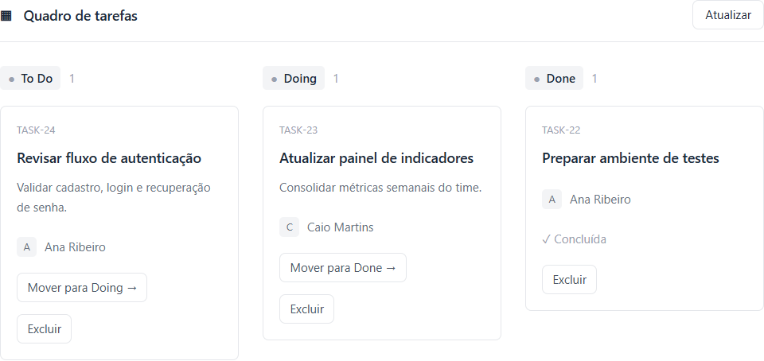

# 🎯 TaskCorp Insights

Aplicações web corporativas para gestão de tarefas e controle de produtividade para squads de desenvolvimento.

> **Tech Stack:** Angular (Standalone) · Node.js (Express & TypeScript) · SQL Server · Tailwind CSS

---

## 📋 Sobre o Projeto

O **TaskCorp Insights** é um sistema completo de gestão de entregas e produtividade, contando com autenticação, autorização baseada em cargos (RBAC) e persistência em banco relacional **SQL Server**.

## 🖥️ Telas do Sistema

As telas de acesso foram capturadas em viewport desktop (1440 × 1000). O quadro do painel mostra as três colunas em layout desktop, com dados fictícios de demonstração.

### Login


### Cadastro


### Recuperação de Senha


### Painel de Tarefas



---

## 🛠️ Tecnologias Utilizadas

* **Front-end:** Angular (Componentes Standalone, RxJS, Formulários Reativos) & Tailwind CSS
* **Back-end:** Node.js, Express, TypeScript
* **Banco de Dados:** SQL Server
* **Segurança & Versionamento:** JWT, RBAC, Migrations automatizadas, Git

---

## 🚀 Instalação e Configuração

### 1. Instalar Dependências

Execute o comando de instalação limpa nas pastas do projeto:

```bash
# No diretório /backend
npm ci

# No diretório /frontend
npm ci

```

### 2. Configurar Variáveis de Ambiente

Crie o arquivo `.env` dentro da pasta `backend/` utilizando o modelo `backend/.env.example` como base:

```bash
cp backend/.env.example backend/.env

```

### 3. Migrations e Bootstrap do Administrador

Forneça as credenciais de migrations separadas e execute os scripts de inicialização no diretório `backend`:

```bash
# Executar as migrations do banco de dados
npm run migrate

# Criar/inicializar a conta de administrador
npm run bootstrap-admin

```

> **Nota de Segurança:** Contas antigas são preservadas e permanecem inativas até receberem uma nova senha por meio do fluxo administrativo controlado.

---

## 💻 Execução em Desenvolvimento

1. **Back-end:**
```bash
npm run start:local

```


2. **Front-end:**
```bash
npm start

```


* A interface rodará em: `[http://127.0.0.1:4201](http://127.0.0.1:4201)` (com proxy encaminhando requisições `/api` para a API local).
* Certifique-se de configurar a variável `FRONTEND_ORIGIN` no `.env` do backend com a origem exata: `[http://127.0.0.1:4201](http://127.0.0.1:4201)`.

---

## 🧪 Validação e Testes

Para validar o código e garantir a conformidade de segurança e compilação:

```bash
# Testes unitários do backend
npm test

# Build de produção (em ambos: backend e frontend)
npm run build

# Auditoria de segurança de dependências (em ambos)
npm run audit:security

```

> ℹ️ **Teste Integrado de Fumaça (`backend/tests/security-smoke.cjs`):**
> Utiliza um banco isolado dedicado e requer credenciais locais de administração. Este teste é exclusivo para validação local e **não faz parte do pipeline de deploy**.

---

## 🔒 Segurança e Operações

Para instruções detalhadas sobre **configuração avançada, TLS/SSL, RBAC, rotinas de backup, restauração e disaster recovery**, consulte a documentação dedicada:

👉 **[SECURITY-OPERATIONS.md](https://www.google.com/search?q=SECURITY-OPERATIONS.md)**

---

## ⚠️ Aviso de Produção

Os arquivos de configuração e modelos disponibilizados neste repositório devem ser parametrizados com domínio, certificados digitais e segredos reais antes do envio a ambientes produtivos. **Não execute o ambiente de demonstração/local em produção.**